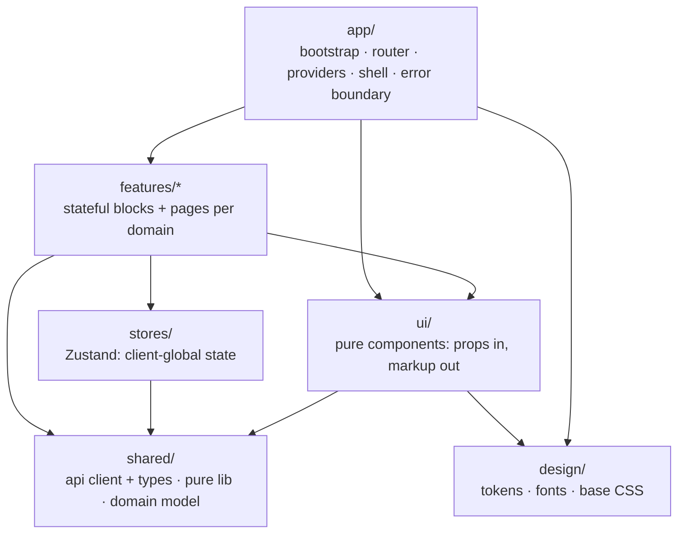
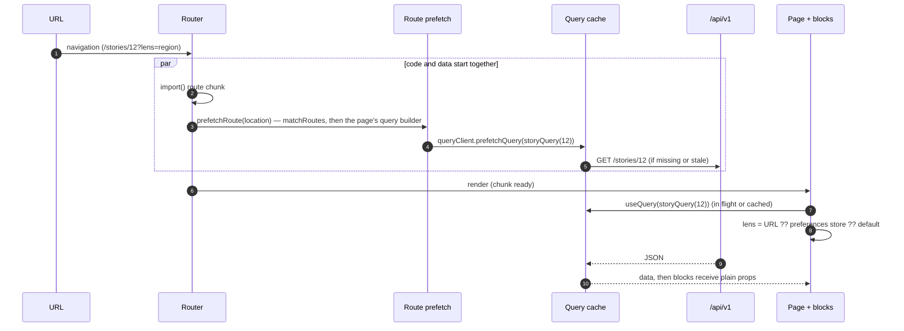

# Frontend system architecture

**Status:** implemented 2026-10-11 (decisions in [ADR-023](../DECISIONS.md#adr-023-a-layered-frontend-chosen-by-measurement), [ADR-024](../DECISIONS.md#adr-024-an-editorial-identity--colour-belongs-to-data), [ADR-025](../DECISIONS.md#adr-025-story-link-previews-for-crawlers-only)). Section 0 keeps the original audit (measured against `2532da1`); sections 1–4 describe the system as built; the [implementation record](#implementation-record) says where the build departs from the first plan, and why.
**Scope:** the React app in `frontend/` and how it is delivered (Vite build, Caddy). Backend only where it shapes the frontend.

Each section gives the state before (measured, not estimated), the target, the rules that keep it in place, and the migration steps.

## Implementation record

Every phase was measured before it was kept: unit and end-to-end tests, screenshots in light, dark and phone layouts, and cold loads on a slow phone (1.6 Mbit/s, 150 ms, CPU slowed 4×) against the previous build.

| Decision | Planned | Built | Why it changed |
|---|---|---|---|
| D1 layers | adopt | adopted, ESLint-enforced (every rule checked against a deliberate violation) | — |
| D2 global state | Zustand | Zustand: `stores/preferences` (theme, lens), `stores/reading` | — |
| D3 lens in the URL | adopt | `?lens=` wins over the remembered lens | — |
| D4 fonts | Newsreader + Atkinson Hyperlegible Next/Mono | **the system sans for everything, headlines heavy** (ADR-028; Newsreader until then) | Ground News' look is one heavy sans; Atkinson has no plain zero ("1Ø Oct" in every date); Schibsted Grotesk cost ~370 ms to first content as a preloaded 47 KB face |
| D5 perspective colours | a non-partisan pair | **Ground News' maroon / light neutral / navy** (ADR-028) | The product follows Ground News, and its screenshots show the left in maroon and the right in navy (the blue-left reading kept until ADR-028 was a mistake). Links in a data colour are solved by D6 |
| D6 ink-on-paper chrome | adopt | adopted; control borders now ≥ 3:1 (were 1.75:1) | — |
| D7 link previews | defer | **built**: crawler-only, ADR-025 | Sharing is how news travels here |
| Router | data router with loaders | **`BrowserRouter` + prefetch on route entry** | The data router added 13 KB to every page and measured slower; the same per-page query builders now run when a route is entered |
| Styling | CSS Modules | **one stylesheet per layer and component**, global class names | CSS still splits per chunk; hashed class names would have rewritten every test selector for no user gain |
| Query keys | hierarchical | `[path, params]` | The app never writes, so nothing needs group invalidation |

**Outcome** (details in [TESTING.md](../TESTING.md#frontend-cold-loads-on-a-slow-phone)): first content on a cold story link 2.26 → 2.00 s, home 2.41 → 2.36 s, layout shift 0.23–0.33 → 0.002, LCP within 2.5 s. Entry bundle 103 KB gzipped (was 99), fonts 38 KB, all guarded by `npm run check:budget`. All eleven audit findings are fixed.

---

## 0. Baseline and audit findings

### What exists today

| | |
|---|---|
| Stack | React 19.3, React Router 7.18 (declarative `<Routes>`), TanStack Query 5, Recharts 3, Vite 8 (Rolldown), plain CSS |
| Source | 5.6k lines: `api/` (client, 1 hook per endpoint, 370 lines of hand-written types), `components/` (9 files), `lib/` (5), `pages/` (12 files, 17 routes), `styles/` (`tokens.css` 151 lines, `app.css` 961 lines) |
| Routing | every route is `React.lazy`; one `<Suspense>` at the root; **no error boundary** |
| State | server data in React Query (`staleTime` 60 s, `keepPreviousData`); filters in the URL (`useFilters`); 3 browser-stored preferences, each with its own hand-written pattern (theme: `useState` + effect; lens: `useState` per hook instance; reading history: `useSyncExternalStore` store) |
| Styling | semantic CSS variables, data palettes validated with the palette validator (ADR-011); one global stylesheet with BEM-style classes; system font stack |
| Tests | Vitest (35), Playwright + axe (62 = 31 scenarios × desktop/mobile) |

### Bundle (production build, gzip -9)

| Load | JS gz | Notes |
|---|---:|---|
| Entry closure (every page) | **95.2 KB** | `react` chunk 83.2 (react-dom, react-router, scheduler, react-redux*), `index` 15.1 (TanStack Query core + app shell), runtime 0.4 |
| CSS (every page) | 4.1 KB | one file, 15.9 KB raw |
| `/` Stories feed | +8.6 KB | **≈108 KB total**, no chart library |
| `/stories/:id`, `/blindspot`, `/my-news`, `/sources/:slug`, `/articles` | +5–9 KB each | |
| `/dashboard`, `/trends`, `/topics`, `/entities`, `/sources` | +109–112 KB each | Recharts chunk 106.9 KB is shared by all of them |

\* `react-redux` is used only by Recharts, but `manualChunks` matches `id.includes("node_modules/react")`, so it lands in the eagerly loaded `react` chunk. A stricter rule measured **−1.1 KB gz** on the critical path. This is real but small, so it is P2.

### Findings, ranked

| # | Severity | Finding | Evidence |
|---|---|---|---|
| F1 | **P0** | **A failed chunk load blanks the app.** There is no error boundary, so a rejected `import()` (offline, or an open tab after a deploy has removed the old hashed chunks) unmounts the whole tree. | `main.tsx`: one `<Suspense>`, no `ErrorBoundary`/`errorElement` anywhere in `src/` |
| F2 | **P0** | **Missing chunks are answered with `index.html` and cached for a year.** `try_files {path} /index.html` also covers `/assets/*`, so a missing chunk returns HTML with status 200, and `@hashed` marks that response `immutable, max-age=31536000`. A request that reaches the server during a deploy switchover can poison that chunk URL for that browser. | `frontend/Caddyfile`, `handle` block |
| F3 | P1 | **Deep links have no `Cache-Control`.** `@html` matches only `/` and `/index.html`. Caddy runs `header` before `try_files`, so `/stories/12` (served from `index.html`) gets no header and browsers cache it heuristically. That can serve stale HTML pointing at deleted chunks, which leads into F1. `/theme.js`, `/manifest.webmanifest` and the icons have the same gap. | `Caddyfile`; Caddy directive order |
| F4 | P1 | **The data request waits for the code (request waterfall).** A cold `/stories/12` goes HTML → entry JS → route chunk → only then `GET /api/v1/stories/12`. The API call could start at route match, in parallel with the chunk. | `useStory` runs inside the lazy page |
| F5 | P1 | **Brand accent = "Left".** Links, focus and active UI use `--accent` `#2a78d6`, which is also `--bias-left`, `--cat-1` (Albania) and the factuality ramp. On a product about bias, every link reads as left-leaning. | `tokens.css` |
| F6 | P1 | **No type, spacing or motion system.** 22 distinct `font-size` values, 8 weights (400/450/520/600/620/640/650/700), 61 distinct padding/gap/margin declarations, 76 inline `style={{}}` in TSX. Only colour is tokenised. | `grep` over `app.css` and `src/**/*.tsx` |
| F7 | P2 | **A keystroke re-renders the whole page.** Search-input state lives in the page component, so each keystroke re-renders the feed (15 `StoryCard`s plus the sidebar) on Stories, Articles and Entities. Cheap today, but it is the pattern that scales badly. | `Stories.tsx` `const [text, setText]` |
| F8 | P2 | **Every URL change re-renders the shell and lists.** `Layout` calls `useLocation()` (for focus management) and `ArticleList` calls `useFilters()` (only to build links), so both re-render on every search-param change. | `Layout.tsx`, `components/lists.tsx` |
| F9 | P2 | **Three persistence patterns for three preferences.** The lens preference is per hook instance, so two pickers on one page would disagree, and it does not sync across tabs. Reading history does sync. | `lib/reading.ts`, `Layout.tsx` |
| F10 | P2 | **API types are hand-mirrored** from the Pydantic schemas (370 lines). Drift is caught only by e2e tests. | `api/types.ts` |
| F11 | P2 | **Story links share the site-wide preview.** The SPA serves one `index.html`, so a story shared on social media shows the generic title and image. | `index.html` OG tags |

What is already right and should be kept: route-level splitting, charts kept off the home route, `keepPreviousData` with dimmed refetch, URL-owned filters, the Card loading, error and empty contract, the validated data palettes, and the reduced-motion and forced-colors handling.

---

## 1. Component boundaries and hierarchy

### Layers

Dependencies point one way, downward. A layer may import only from the layers below it.



| Layer | Owns | May import | Must not |
|---|---|---|---|
| `design/` | CSS custom properties, `@font-face`, reset/base | nothing | contain selectors for components |
| `shared/` | `fetch` client, generated API types, pure functions (`format`, URL parsing), domain model (`ratings`: domain value → label and token name) | `design` (token *names* only) | import React Query, the router, stores, or React components |
| `ui/` | pure components: `Button`, `Segmented`, `Field`, `Badge`, `Card`, `States`, `StatTile`, `CoverageBar`, `RankList`, `charts/*` | `shared/lib`, `shared/model`, `design` | fetch data, call router hooks, read stores, know an endpoint exists |
| `stores/` | client-global state (Zustand) | `shared` | hold server data or anything the URL can hold |
| `features/<domain>/` | query options, stateful blocks (`StoryFeed`, `HeadlineColumns`), pages | `ui`, `shared`, `stores`, and **another feature's `index.ts` only** | deep-import another feature; create import cycles |
| `app/` | `main.tsx`, router table, `QueryClient`, shell (header/nav/footer), `ErrorBoundary`, route focus | everything | contain domain logic |

`ui/Card` keeps its structural `QueryLike` interface. It renders loading, error and empty states for any object of that shape without importing React Query. That decoupling already exists and is the model for the rest of `ui/`.

### Folder structure

```
frontend/src/                    (as built)
├── app/
│   ├── main.tsx                 bootstrap: providers, preferences, chunk-load recovery
│   ├── router.tsx               route table, prefetch on route entry (matchRoutes), AppRoutes
│   ├── scrollMemory.ts          Back restores the position, retrying while the page fills in
│   ├── queryClient.ts           retry rules (freshness is per query)
│   ├── Shell.tsx · shell.css    masthead, navigation, footer, site notice, page boundary
│   ├── RouteFocus.tsx           focus to <main> on client-side navigation (F8)
│   ├── RouteError.tsx           page error boundary + chunk-load reload once (F1)
│   ├── ThemeToggle.tsx · preferences.ts · chunkReload.ts
├── design/
│   ├── tokens/{color,type,space,motion}.css
│   ├── base.css · primitives.css · index.css
├── shared/
│   ├── api/                     client.ts · types.ts (hand-written) · openapi.json (the API's schema)
│   │                            schema.gen.ts (generated) · contract.check.ts (compile-time contract)
│   ├── query/apiQuery.ts        one query definition per endpoint + freshness classes
│   ├── hooks/                   useFilters (URL state), useTitle
│   ├── lib/                     format, ids
│   └── model/ratings.ts         domain values → labels and token names
├── stores/                      preferences.ts (theme, lens) · reading.ts (my news bias) · storage.ts
├── ui/                          Card · States · StatTile · CoverageBar · RankList · SentimentChip
│                                SearchField · charts (Recharts, lazy routes only), each with its CSS
└── features/
    ├── stories/   api · queries · StoryCard · StoryCoverage · StoryTrace · useLens · lensGroup
    │              stories.css · pages/{Feed, Story, Blindspot} · index
    ├── sources/   api · queries · pages/{Sources, SourceProfile} · index
    ├── reading/   queries · readingCoverage · pages/MyNews · index
    ├── analytics/ api · queries · pages/{Overview, Trends, Topics, Entities} · index
    ├── articles/  api · queries · ArticleList · articles.css · pages/Articles · index
    ├── filters/   FilterBar · index
    └── system/    api · StatusBanners (status pill, site notice) · system.css · pages/Info · index
```

Tests stay next to their files (`*.test.tsx`), as they are now.

### Enforcement, with no new dependency

A `@/*` → `src/*` path alias (tsconfig `paths` + Vite `resolve.alias`) makes every cross-layer import name its layer, so ESLint's built-in `no-restricted-imports` can enforce the arrows using the flat config the repo already has:

```js
// eslint.config.js (sketch). Relative imports stay inside a folder; "../../*" is banned everywhere.
const LEAVE_FOLDER = { group: ["../../*"], message: "Cross a layer through the @/ alias." };
{ files: ["src/ui/**"], rules: { "no-restricted-imports": ["error", { patterns: [LEAVE_FOLDER,
  { group: ["@tanstack/*", "react-router*", "zustand*"], message: "ui/ is pure: pass data and callbacks in." },
  { group: ["@/features/*", "@/stores/*", "@/app/*", "@/shared/api/*"], message: "ui/ may import shared/lib, shared/model, design only." },
]}]}},
{ files: ["src/shared/**"], rules: { "no-restricted-imports": ["error", { patterns: [LEAVE_FOLDER,
  { group: ["react", "@tanstack/*", "react-router*", "zustand*", "@/ui/*", "@/features/*", "@/stores/*", "@/app/*"] },
]}]}},
{ files: ["src/features/**"], rules: { "no-restricted-imports": ["error", { patterns: [LEAVE_FOLDER,
  { group: ["@/features/*/*"], message: "Import another feature through its index (@/features/<name>)." },
]}]}},
```

Flat config replaces a rule's options per matching block rather than merging them, so each folder's block repeats the shared pattern. If this proves too loose, `eslint-plugin-boundaries` is the heavier fallback.

`shared/lib/useTitle.ts` is a React hook. It moves to `app/` or `features/system/`, or the `shared/` rule gets a narrow exception. This is decided during the move.

### Component contracts

- **ui components** take data and callbacks as props, render semantic HTML, and style only through tokens. Every visual state (loading, empty, error, disabled, pressed) is a prop, never a fetch. Each gets a Vitest render test. Dark mode needs no test of its own, because it comes from tokens.
- **Feature blocks** own exactly one concern: they call one or more query hooks, read URL or store state, and pass plain props down. Pages are thin compositions of blocks.
- **Styling:** one stylesheet per layer and component (`design/` tokens, base and primitives; `app/shell.css`; `ui/*.css`; `features/*/*.css`), imported by the component that owns it, so CSS splits per lazy chunk. Class names stay global (the end-to-end tests select by them). Inline `style={{}}` is used only for data-driven values (`--tick`, `--col-color`, segment widths and colours); `npm run check:tokens` rejects any raw colour outside `design/tokens/`.

---

## 2. State and data-flow topology

### Four homes for state

| Home | Holds | Library | Persistence | Examples |
|---|---|---|---|---|
| **Server cache** | anything the API returns | TanStack Query | memory (`gcTime`), plus HTTP cache | stories, story detail, sources, analytics, status |
| **URL** | what defines *what is shown* and must survive share, reload and back | React Router search params | the link itself | `days`, `source`, `sort`, `topic`, `country`, `q`, `page`, `kind`, **`lens` (new, overrides the preference)** |
| **Client-global** | user preferences and history that outlive a page and are not shareable | **Zustand** + `persist` | `localStorage` (only in this browser, ADR-022) | theme, default lens, reading history |
| **Local** | ephemeral, single-component interaction state | `useState` / `useReducer` | none | search draft before debounce, Card chart/table toggle |

**Where does a new piece of state go?** Ask in order. Did it come from the API? Then the server cache. Should a shared link reproduce it? Then the URL. Must it survive navigation or reload, or be read by unrelated components? Then the Zustand store. Otherwise it is local, kept in the lowest component that needs it.

**Hard rules**
1. Server data is never copied into Zustand or `useState`. Derive with `select` or `useMemo` from the query result.
2. Nothing representable in the URL goes into a store. The store holds *defaults*; the URL holds the *current* view (for example, `lens` param ?? stored lens ?? computed default).
3. Stores never fetch. Query functions never read stores. Anything a query depends on goes in its key, as a parameter.

### Is Zustand worth adding?

At today's size it is a **consistency** win, not a performance win. It replaces three hand-written persistence patterns (≈80 lines) with one, fixes the per-instance lens state (F9), and gives selector subscriptions. Cost: a small runtime dependency (low single-digit KB gz with `persist`; measure on adoption). If it is declined, the fallback is one `createPersistedStore()` helper on `useSyncExternalStore`, the pattern `reading.ts` already uses. That is decision **D2** in §6.

```ts
// stores/preferences.ts (sketch)
type Theme = "light" | "dark" | "system";
interface Preferences { theme: Theme; lens: Lens | null; setTheme(t: Theme): void; setLens(l: Lens): void }
export const usePreferences = create<Preferences>()(persist(
  // initial values read today's keys (gjurme-theme, gjurme-lens) once, so no reader loses a setting
  (set) => ({ theme: legacyTheme(), lens: legacyLens(), setTheme: (theme) => set({ theme }), setLens: (lens) => set({ lens }) }),
  { name: "gjurme-prefs", version: 1, storage: createJSONStorage(() => safeLocalStorage) },
));
// subscribe to one primitive, never the whole store:
const lens = usePreferences((s) => s.lens);
```

Two requirements carry over from the current code:
- **Storage may throw** (private mode, blocked storage), so `safeLocalStorage` wraps every call in `try/catch`. Without storage the app still works for the page view.
- **Cross-tab sync.** Reading history updates other tabs today. `persist` does not do that by itself, so a `storage` event listener calls `usePreferences.persist.rehydrate()` (and the same for `reading`).

`public/theme.js` stays. It applies the theme before first paint, which no store can do. It is updated to read the new key.

### Data flow



- **One query definition per endpoint** (`apiQuery` in `shared/query/apiQuery.ts`, used by each feature's `api.ts`): key `[path, params]`, fetcher and freshness class. The app never writes, so no key hierarchy is needed.
- **One query builder per page** (`features/*/queries.ts`, e.g. `feedQueries(url)`), a pure function of the URL. The page reads its queries from it, and `prefetchRoute` (in `app/router.tsx`) calls the same function the moment a route is entered, so the prefetch fills exactly the cache entries the page reads (a unit test checks this). Prefetching never blocks: the page keeps its own loading, error and empty states (F4).
- **Previous data** stays on screen only while the *same* resource refetches with new filters; another story or entity never shows the previous one's data.
- **Hover and focus prefetch** on story links (after a 120 ms hover, at once on focus) fetches the story and its page code; the feed loads the story page's code when idle.

**Freshness by resource class.** The pipeline refreshes every 15 minutes, and the API sends `Cache-Control: public, max-age=60, stale-while-revalidate=120`:

| Class | Examples | `staleTime` | Other |
|---|---|---|---|
| `feed` | stories, story, blindspots, articles | 60 s | `refetchOnWindowFocus: true`, so a returning reader sees new stories (today it is off globally) |
| `analytics` | overview, volume, trends, entities, sources | 5 min | changes only when the pipeline runs |
| `static` | topic taxonomy | `Infinity` | changes only with a deploy |
| `status` | `/status` | 60 s | `refetchInterval: 5 min` while visible, so the "Updated …" pill stays honest |

### Re-render rules (and where they apply today)

1. **Colocate ephemeral state.** The search draft moves into `features/stories/SearchField`, which keeps its own text and writes `q` to the URL after a 350 ms debounce. Keystrokes then re-render one input, not the feed (F7, same on Articles and Entities).
2. **Subscribe narrowly.** Zustand selectors return primitives. Query consumers that need one field use `select` (for example, the status pill needs `status` and `last_success_at`), and structural sharing then suppresses re-renders when other fields change.
3. **Keep router hooks out of leaves.** `ArticleList` gets prebuilt `href`s, and the focus/scroll effect moves to a `RouteFocus` sibling so the shell no longer subscribes to `useLocation` (F8).
4. **Memoise only what was measured.** Lists are ≤ 20 items (feed 15, articles 20), so virtualisation and blanket `memo` are not needed. Profile with the React DevTools profiler first. React Compiler is worth evaluating once its Vite 8 integration is confirmed, as a separate change.

---

## 3. Performance and scalability strategy

### Budgets (enforced in CI)

| Budget (gzip) | Before | Built | CI limit (`budgets.json`) |
|---|---:|---:|---:|
| Entry, JS + CSS, every page | 99.3 KB | 107.8 KB | 110 KB |
| Home page total | ≈108 KB | 118.8 KB | 122 KB |
| Any non-chart route | 5–9 KB | 3–11 KB | 15 KB |
| Chart route | 109–112 KB | 111–117 KB | 119 KB |
| Fonts (all files, all subsets) | 0 | 38 KB, none preloaded | 48 KB |
| LCP, slow phone | 1.7–1.8 s | 1.8–2.0 s | ≤ 2.5 s (measured, not in CI) |
| Layout shift | 0.23–0.33 | 0.002 | ≤ 0.05 (measured, not in CI) |

The Albanian interface (default) raised the entry by 2.8 KB and chart routes by up to 1.9 KB, and the limits by 4 KB each: the build hands every module only the Albanian of the strings it uses (`vite.config.ts`, `translations`), so a page carries its own text rather than the whole 12 KB catalog.

`frontend/scripts/budget.mjs` walks Vite's build manifest from the entry and from each route, gzips what a visit downloads and fails CI above a limit. Raising a limit is a reviewed change to `budgets.json`. The manifest is not shipped (the Dockerfile deletes it).

### Code splitting

1. **Keep route-level `lazy`**, and start each route's requests when it is entered, in parallel with its code (F4). A data router does this natively but added 13 KB to every page and measured slower; a 30-line `prefetchRoute` does the same with `matchRoutes`.
2. **Make the vendor rule exact.** `/node_modules\/(react|react-dom|react-router|react-router-dom|scheduler)\//` moves `react-redux` and `use-sync-external-store` into the Recharts chunk (−1.1 KB gz measured).
3. **Prefetch the likely next chunk.** Done: After the feed renders, on `requestIdleCallback` (falling back to `setTimeout`), prefetch the Story route chunk; hover and focus prefetch covers the rest.
4. **Recharts stays for now.** It costs nothing on the home and story routes. Replacing it with hand-rolled SVG (as `CoverageBar` already does) would save ≈90 KB on five secondary routes but rewrite 8 chart components. Revisit only if the dashboard becomes a primary entry route.
5. **Do not split further.** Chunks under 2 KB (`StatTile`, `filters`, `FilterBar`) cost more in requests than they save. Leave them, and revisit only if request count shows up in the LCP trace.

### Delivery and caching layers

| Layer | Today | Target |
|---|---|---|
| **Browser HTTP: hashed `/assets/*`** | `immutable, 1y` | unchanged, but **a missing asset returns 404, not `index.html`** (F2) |
| **Browser HTTP: HTML, deep links, unhashed files** | only `/` and `/index.html` get `no-cache` | `no-cache` (ETag revalidation) on **everything outside `/assets/`** (F3) |
| **Browser HTTP: API** | `public, max-age=60, swr=120` (backend) | unchanged; it matches the `feed` `staleTime` |
| **Edge (Caddy)** | compression, no cache | unchanged. One VPS and a 60 s API cache need no edge cache; revisit behind a CDN. |
| **In-app: TanStack Query** | 60 s for everything | per-class freshness (§2) |
| **Service worker** | none | **none**. Offline news is stale news, and a broken SW is hard to recover. Revisit only for a real install or offline requirement. |

```caddy
handle {
    root * {$SITE_ROOT:/srv}
    @asset_file {                          # an existing build file
        path /assets/*
        file
    }
    handle @asset_file {
        header Cache-Control "public, max-age=31536000, immutable"
        file_server
    }
    handle /assets/* {                     # a missing chunk: a real 404, never cached (F2)
        header Cache-Control "no-store"
        respond 404
    }
    handle {
        header Cache-Control "no-cache"    # HTML of every route, theme.js, manifest, icons (F3)
        try_files {path} /index.html
        file_server
    }
}
```

Verified against Caddy 2.11.4 (and in the end-to-end suite). `try_files` must sit inside the last `handle`: at the outer level Caddy runs it before `handle`, rewriting `/assets/missing.js` to `/index.html`. The long cache applies only to files that exist, so a 404 during a deploy switchover cannot be cached for a year.

### Deploy-skew resilience (F1)

- `app/RouteError.tsx` wraps each page inside the shell (and the whole app as a last resort). If the error is a chunk-load failure (`TypeError: Failed to fetch dynamically imported module`, or Vite's `vite:preloadError` event), it reloads **once**, guarded by a `sessionStorage` timestamp so it cannot loop. Otherwise it shows the existing `ErrorState` with "Try again" and keeps the shell and navigation usable.
- With F2 and F3 fixed, a reload always gets fresh HTML and current chunks.

### Fonts (see §4)

None since ADR-028: headlines and interface use the reader's system sans (zero bytes; every platform's face has the Albanian and regional letters). Until then Newsreader 600 was self-hosted (38 KB); a preloaded interface face had delayed first content by ~370 ms on a slow connection. The fonts budget is 0, so a new face has to argue for itself in `budgets.json`.

### Link previews (F11)

Built ([ADR-025](../DECISIONS.md#adr-025-story-link-previews-for-crawlers-only)): Caddy sends link-preview crawlers — by User-Agent, never search engines or readers — for `/stories/{id}` to `/api/share/stories/{id}`, a static HTML page with the story's title, who covered it, canonical URL, image and a redirect to the real page. Metadata only, every value escaped, the API's strict CSP.

---

## 4. Anti-convergence design system

### The stance

GJURMË is a product *about* how outlets differ. The design follows from that:

1. **Colour belongs to data.** Every hue on screen encodes something: perspective, region, ownership, factuality or status. The chrome (text, links, navigation, focus, borders) is **ink on paper**. This fixes F5 for good: a link can never look "left".
2. **Identity comes from typography and the trace,** not from a brand gradient. Headlines in a news serif, in the outlets' own language. The *gjurmë* (trace) motif appears as thin rules and the story timeline.
3. **Editorial, not dashboard-SaaS.** Hairline rules and spacing separate content instead of rounded, shadowed cards. Dense where data is dense; a generous reading measure where text is long.

### Token tiers

| Tier | Purpose | Example | Who may use it |
|---|---|---|---|
| 1. Primitive | raw validated steps | `--blue-600: #2a78d6` | tier 2 and 3 tokens only |
| 2. Chrome role | UI meaning | `--paper`, `--ink`, `--link`, `--rule`, `--focus` | all components |
| 3. Data role | encoding meaning | `--bias-left`, `--cat-3`, `--fact-high`, `--unrated` | data marks only (bars, dots, chart series) |

CI guard (a `grep` in the Frontend job): no hex, `rgb()` or `hsl()` outside `design/tokens/` (it holds today, with 0 occurrences), and no tier-3 token in a non-data selector.

### Colour

**Chrome.** All text pairs checked for WCAG contrast (computed, not estimated):

| Token | Light | Dark | Contrast (light/dark) |
|---|---|---|---|
| `--paper` (page) | `#f4f2ec` newsprint | `#121211` | — |
| `--surface` (cards, **all data marks sit here**) | `#fcfcfb` (unchanged) | `#1a1a19` (unchanged) | — |
| `--ink` | `#0b0b0b` | `#f2f0ea` warm white (was `#fff`) | 17.6 / 16.5 on paper |
| `--ink-2` | `#52514e` | `#c3c2b7` | 7.1 / 10.5 on paper |
| `--ink-muted` | `#686660` | `#9a9890` | 5.1 / 6.5 on paper |
| `--link` | `= --ink`, underlined; 2px underline on hover | `= --ink` | as ink |
| `--focus` | `= --ink`, 2px ring, 2px offset | `= --ink` | ≥ 15:1 |
| `--rule` | `rgba(11,11,11,.12)` hairline | `rgba(255,255,255,.12)` | non-text |
| `--rule-strong` | `#c3c2b7` (column rules, active-nav underline) | `#383835` | non-text |

The data marks keep their **validated surface**. Only the page background warms up. Run against the warmer `#f6f3ec` as a chart surface, the validator dropped a fourth categorical slot (`--cat-2`) below 3:1. So data never sits directly on `--paper`.

**Data.** The validated tokens in today's `tokens.css` are unchanged (categorical slots 1–6 in fixed order, ordinal factuality ramp, diverging perspective, hatched unrated). Validator, 2026-10-11:
- Light categorical: all checks pass. Contrast warns for 3 slots, and the coverage bars already carry the required relief (printed percentages, 2px gaps).
- Dark categorical: all checks pass, including contrast.

**Decision D5: perspective colours are Ground News' maroon / light neutral / navy** (ADR-028; until then blue / gray / red, wrongly taken for Ground News'). The methodology page states that the colours carry no party meaning. A non-partisan pair was considered and rejected: the product follows Ground News, whose readers already read its bars, and the actual confusion — links drawn in a data colour — is gone with the ink chrome.

### Type

| Role | Face | Why this one |
|---|---|---|
| **Headlines** (story titles, page titles; mostly Albanian text) | **the system sans, weight 700, tight tracking** (ADR-028) | Ground News' look. Newsreader 600, the serif used until then, is gone with its 38 KB. The masthead word uses a condensed cut where the platform has one (`--font-mast`). |
| **Interface, body and figures** | **the system font** (`system-ui`: SF, Roboto, Segoe UI) | Zero bytes and native on every device. Tabular figures only where numbers stack (table cells, tooltips). Atkinson Hyperlegible draws a slashed zero in every date; Schibsted Grotesk cost ~370 ms of first content on slow connections. |

Verified with fontTools before adoption: every glyph Albanian and the regional names need (ë ç č ć š ž đ), and the file sizes against the budget.

Stacks: `system-ui, -apple-system, "Segoe UI", Roboto, "Helvetica Neue", Arial, sans-serif` (text and headlines) and `"Arial Narrow", "Roboto Condensed", … , Arial, sans-serif` (the masthead word).

**Scale.** It replaces the 22 ad-hoc sizes. Steps are spaced so neighbouring roles are clearly distinct.

| Token | Size | Line height | Use |
|---|---|---|---|
| `--text-xs` | 0.75rem (12) | 1.35 | meta, legends, badges |
| `--text-sm` | 0.8125rem (13) | 1.4 | secondary UI, table cells |
| `--text-base` | 0.9375rem (15) | 1.55 | body, controls |
| `--text-md` | 1.0625rem (17) | 1.35 | card titles, story-card headline (serif) |
| `--text-lg` | 1.25rem (20) | 1.25 | section titles, lead-story headline (serif) |
| `--text-xl` | 1.5rem (24) | 1.2 | page titles |
| `--text-display` | `clamp(1.75rem, 1.2rem + 1.8vw, 2.375rem)` | 1.1 | story page headline (serif) |

Weights: sans 400 and 600 only; serif 600 only (8 weights become 3). Measure: body text ≤ 70ch, headlines ≤ 32ch. Tabular figures wherever numbers stack.

### Space, shape, depth

- Spacing: `--space-1…7` = 4 · 8 · 12 · 16 · 24 · 32 · 48 px. The 61 distinct declarations snap to these.
- Radius: `--radius-sm 2px`, `--radius 4px` (from 6/10). Circles stay only where the shape means something (source dots, status dot).
- Depth: no shadows on content. Cards are separated by `--rule` hairlines and `--space-5`. Shadow is kept only for things that float (popovers, the sticky header once scrolled).

### Motion orchestration

Tokens: `--dur-instant 80ms` · `--dur-quick 140ms` · `--dur-base 200ms` · `--dur-slow 320ms`; `--ease-out cubic-bezier(.2,.7,.2,1)` · `--ease-in-out cubic-bezier(.45,0,.2,1)`.

Rules:
1. **Motion explains a change in data or state, never decorates.** Allowed: refetch dim (opacity, `--dur-quick`), a new value crossfading in, a coverage bar re-proportioning *within* a lens on data refresh (`flex-grow`, `--dur-base`), disclosure open/close, the chart/table toggle.
2. **Nothing animates on page load.** No staggered card fade-ins, no count-up numbers, no skeleton shimmer longer than the actual wait (prefer a static skeleton; shimmer only after 400 ms).
3. **One thing moves at a time.** Exit is faster than enter (`--dur-instant` vs `--dur-quick`). Route changes cut; they don't slide.
4. **Only `opacity` and `transform`,** plus the coverage-bar `flex-grow` exception (≤ 4 segments × ≤ 15 cards).
5. **Reduced motion:** the existing global guard stays, and charts keep `isAnimationActive={!still}`.

### Signature element: the trace

The story page timeline becomes a **horizontal trace**: one hairline across the column, one tick per outlet report at its publish time, coloured by the current lens, with the first report marked and labelled. It is the product's name drawn as data ("who left a mark on this story, and when"), and the one place the design takes a visual risk. Story cards carry a 3px version of the coverage bar as their top rule, so the feed reads as a column of traces.

### Never

- a brand gradient, glassmorphism, or a purple-to-blue hero;
- a hue in the chrome that also encodes data (F5);
- Inter, Roboto, or the bare system stack as the brand face;
- rounded-xl cards with soft drop shadows as the default container;
- emoji as icons (the theme toggle's ☾ ☀ ◐ glyphs become drawn SVG icons);
- a chart without a table view, or colour as the only carrier of meaning (existing rule, kept).

---

## 5. Migration (done)

The phases shipped in this order, each as one commit with every test green: resilience (Caddy cache and 404 fix, chunk-load recovery, exact vendor chunk); structure (layers, alias, lint boundaries); state (Zustand stores, lens in the URL, colocated search input, route focus); data (query definitions, per-page query builders, route prefetch, freshness classes, hover prefetch); identity (tokens, fonts, ink chrome, the trace, phone filters, stable notice line); measured trims (system interface font, `BrowserRouter`), CI guards (budgets, tokens, API contract) and link previews.

## 6. Root decisions (as first proposed)

| # | Decision | Recommendation |
|---|---|---|
| **D1** | Layering `app → features → ui/shared/stores → design`, with feature folders and lint-enforced boundaries (§1) | **Adopt** |
| **D2** | Zustand for client-global state, versus one in-house `useSyncExternalStore` helper (§2) | **Zustand**, for one pattern and selector subscriptions; the cost is small and measured on adoption |
| **D3** | `lens` in the URL (shared links reproduce the view), with the stored lens as the default | **Adopt** |
| **D4** | Type pairing: Newsreader (headlines) + Atkinson Hyperlegible Next (UI/body) + Atkinson Hyperlegible Mono (figures) | **Adopt**, pending the glyph, `tnum` and size checks |
| **D5** | Perspective colours: US blue-left/red-right, European red-left, or a non-partisan pair | **Non-partisan pair**, validated before use |
| **D6** | Ink-on-paper chrome (no brand hue; links and focus in ink), with data marks staying on the validated surface | **Adopt** |
| **D7** | Per-story link previews through a bot-only FastAPI route (§3) | **Defer** to its own backend PR |

The [implementation record](#implementation-record) gives the decision taken for each.
